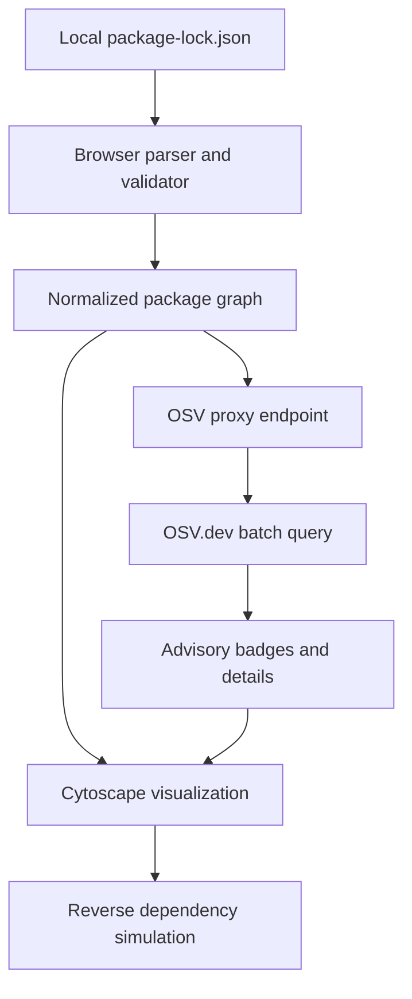

# Dependency Domino

> **One compromised package. How far does it fall?**

**Project type:** Interactive software supply-chain security visualization  
**Team:** 2 developers  
**Hackathon:** 24 hours  
**Primary ecosystem:** npm / Node.js  
**Target deliverable:** A deployed, polished web application with a reliable live demo  
**Document status:** Implementation plan, not completed functionality

## 1. Executive summary

Dependency Domino helps developers understand how much of a software project depends on a particular third-party package. A user imports a `package-lock.json` file, receives an interactive dependency graph, clicks any package, and triggers a **hypothetical compromise simulation**. The graph highlights all packages that depend on the selected package, directly or indirectly, creating a visible domino effect.

The app can also query the [OSV.dev vulnerability database](https://osv.dev/) to identify known security advisories associated with exact npm package versions. Real advisory results and hypothetical compromise simulations must be presented as two different kinds of information.

The central product question is: **If an upstream package becomes untrustworthy, which other parts of my project may inherit that trust risk?**

This is primarily an *exposure visualization and educational tool*. It is not an exploit detector, a malware sandbox, or proof that every dependent package is vulnerable.

### The 30-second pitch

> Modern applications rely on hundreds of third-party packages, many of which developers never chose directly. Dependency Domino turns that invisible supply chain into a visual graph. Upload your lockfile, select one package, and see how the consequences of a hypothetical compromise could spread through the dependencies that rely on it. We also layer in real vulnerability advisories, so teams can distinguish known issues from potential exposure.

### Why this is a compelling hackathon project

- **Immediate visual hook:** One click triggers a graph-wide propagation animation.
- **Real input:** It works on a lockfile from an actual JavaScript project.
- **Clear security relevance:** It illustrates transitive trust and supply-chain exposure.
- **Technically substantive:** Accurate package-instance resolution, graph traversal, vulnerability correlation, and a usable graph interface.
- **Finishable in 24 hours:** One ecosystem, one application, no authentication or database required.

## 2. Scope and success criteria

### Non-negotiable MVP (P0)

1. Accept a local `package-lock.json` file by drag-and-drop or file picker.
2. Validate JSON structure and support npm lockfile versions **2 and 3** through the `packages` map.
3. Convert installed packages and dependency relationships into a graph.
4. Render a readable, zoomable graph with click-to-inspect behavior.
5. Let a user select an installed package instance and start a compromise simulation.
6. Highlight its **reverse dependency closure**, meaning every ancestor that depends on it through one or more resolved paths.
7. Explain the result with a count and at least one dependency path from the root project to the selected package.
8. Reset the animation and select a different package without reloading.
9. Load a bundled demonstration graph if a user has no lockfile.
10. Run a complete local demo with no third-party network access.

### High-value follow-up (P1)

- Query OSV.dev for known advisories against exact npm package name/version pairs.
- Display known advisory IDs, summaries, and links for a selected package.
- Add search, focus-on-selection, and filters for direct/development dependencies.
- Show useful summary metrics, such as installed instances, unique package versions, and the number of exposed ancestors.
- Deploy a working version and record a short backup demo video.

### Optional stretch goals (P2)

- Compare two lockfiles and highlight which exposures changed.
- Simulate the effect of removing a dependency *in the graph*, without changing source files.
- Export a static JSON/Markdown report.
- Import a public GitHub repository after explicit URL selection.
- Add support for Yarn, pnpm, PyPI, or other ecosystems.

### Explicitly out of scope for the 24-hour MVP

- Running or installing uploaded dependencies.
- Detecting malicious code or actually compromising a system.
- Automatically editing `package.json` or recommending guaranteed-safe upgrades.
- General-purpose SBOM parsing, container scans, license compliance, or CI integrations.
- User accounts, persistence, team workspaces, and dashboards of scan history.
- Guaranteed resolution of all npm workspace, peer, alias, linked, Git, or file dependency edge cases.

**Scope rule:** If the real lockfile import, graph, or propagation demo is unstable, stop adding features immediately.

## 3. User experience

### Primary user flow

1. User opens the landing page and reads a one-sentence explanation.
2. They choose **Try Demo** or drop a `package-lock.json` file.
3. The app validates and parses the file. It shows useful errors for unsupported versions or malformed input.
4. A graph appears with the root project, dependencies, and directional edges.
5. The user searches for a package or clicks a node.
6. A side panel shows package name, installed version, dependency type, direct/transitive status, and references.
7. The user clicks **Simulate Compromise**.
8. The selected package becomes the origin, then its dependent ancestors illuminate by distance in the graph.
9. The results panel displays the number of affected ancestor nodes, example paths, and a clear statement that this is a hypothetical exposure model.
10. If OSV results are available, a separate **Known Advisories** section shows actual records.

### Recommended screen layout

| Region | Contents |
|---|---|
| Top bar | Logo, Import Lockfile, Try Demo, Reset |
| Left sidebar | Search, filters, graph summary, legend |
| Main canvas | Pan/zoom dependency network and compromise animation |
| Right sidebar | Selected package details, Simulate Compromise, results, advisory links |
| Footer/status | File version, parsing warnings, OSV status, simulation disclaimer |

### Visual language

- **Neutral:** Standard package node.
- **Blue:** Selected hypothetical origin package.
- **Orange/red:** Ancestor nodes reached by the simulated compromise.
- **Purple or distinct outlined badge:** Package with a verified advisory. Do not use the exact same styling as simulation results.
- **Muted/dashed:** Unresolved or unsupported relationship.
- **Root project:** Larger, labeled node with a unique shape.

Build the first view for legibility, not maximum graph density. Show root + nearby dependencies by default for large projects, with a control to reveal more nodes. A huge force-directed hairball is not a successful visualization.

## 4. Technical architecture

### Recommended stack

| Layer | Choice | Reason |
|---|---|---|
| Application | SvelteKit + TypeScript | One codebase and a familiar development model |
| Graph | Cytoscape.js | Interactive graph manipulation, styling, selection, and layout support |
| Parsing | TypeScript module | Fast local JSON parsing and reusable graph types |
| Security data | OSV.dev REST API | Version-specific vulnerability lookup with batch requests |
| Server component | SvelteKit `+server.ts` endpoint | Proxy OSV queries and normalize responses without a separate backend |
| Styling | Tailwind CSS or simple application CSS | Use whichever is already fastest for the team |
| Tests | Vitest for pure graph/parser functions | Small deterministic fixtures and fast feedback |
| Persistence | None | Not needed to demonstrate the core product |

**Why no FastAPI for the MVP?** With only two developers, a separate Python service would add API contracts, CORS, deployment, and runtime integration work. Python can be introduced later if the product needs richer static analysis.

### Data flow



The raw uploaded lockfile should remain in browser memory for the MVP. Only validated npm package names and versions need to reach the application's server endpoint for OSV lookup. Do not store uploaded files.

### Proposed repository structure

```text
dependency-domino/
  README.md
  package.json
  src/
    lib/
      types.ts
      parser/
        lockfile.ts
        resolve.ts
        lockfile.test.ts
      graph/
        normalize.ts
        impact.ts
        impact.test.ts
      components/
        UploadPanel.svelte
        DependencyGraph.svelte
        PackageDetails.svelte
        ImpactSummary.svelte
      fixtures/
        demo-lockfile.json
    routes/
      +page.svelte
      api/
        vulnerabilities/
          +server.ts
  static/
    logo.svg
```

This is a proposed organization. Keep the actual project simpler if components are not yet large enough to justify separation.

## 5. Dependency graph model

### Critical modeling decision

**A graph node represents an installed package instance at a lockfile path, not just a package name.**

One project can contain multiple versions or copies of the same npm package. Keying nodes only by package name, or even only by `name@version`, can collapse distinct installed locations and produce incorrect edges.

Use the lockfile `packages` map key as the stable installed-instance ID, for example:

- `""` for the root project.
- `node_modules/example`.
- `node_modules/a/node_modules/example`.

### Recommended TypeScript types

```ts
type DependencyKind = 'runtime' | 'development' | 'optional';

interface PackageNode {
  id: string;                  // Exact lockfile package path, or special root ID
  name: string;
  version: string | null;
  direct: boolean;
  devOnly: boolean;
  optional: boolean;
  source: 'registry' | 'link' | 'other' | 'unknown';
  advisoryIds: string[];
}

interface DependencyEdge {
  source: string;              // Consumer package instance
  target: string;              // Required package instance
  kind: DependencyKind;
  requestedRange?: string;
}

interface DependencyGraph {
  nodes: PackageNode[];
  edges: DependencyEdge[];
  warnings: string[];
}

interface ImpactResult {
  originId: string;
  ancestorIds: string[];       // Unique package instances depending on origin
  layers: string[][];          // Breadth-first layers for animation
  samplePaths: string[][];    // Root-to-origin explanatory paths
}
```

### Lockfile parsing rules

1. Parse JSON with a file size and structure limit.
2. Verify `lockfileVersion` is `2` or `3` and `packages` is a plain object.
3. Add a root node based on `packages[""]`, with a safe fallback name.
4. Add installed package nodes for valid paths in `packages`.
5. Infer a package name from the final package component in the `node_modules` path; preserve scoped names such as `@scope/name`.
6. Read `dependencies` and `optionalDependencies` from installed package descriptors. For the root, also handle `devDependencies`.
7. Resolve each requested dependency name to an actual installed instance path.
8. Add directional edges `consumer -> required dependency`.
9. Record unresolved relationships as warnings; do not fabricate edges.
10. De-duplicate repeated edges by `(source, target, kind)`.

For npm v2/v3, the `packages` map is authoritative for the MVP. Do not accidentally treat the top-level legacy `dependencies` map in a v2 lockfile as an additional set of installed copies.

#### Simplified package resolution algorithm

When package `A` declares a dependency on `B`, first look for `B` nested under `A`. If it is not present there, walk up the containing `node_modules` levels until the root-level installed `B` is found. This approximates Node's package lookup structure for ordinary npm installations.

Example candidates for a package installed at `node_modules/a/node_modules/c` that requires `b`:

1. `node_modules/a/node_modules/c/node_modules/b`
2. `node_modules/a/node_modules/b`
3. `node_modules/b`

Use the first candidate present in the `packages` map. Treat workspace links, aliases, and unusual protocols as explicit caveats rather than guessing. For the core demo, choose lockfiles without those cases.

### Why direction matters

The graph should store:

```text
project -> ui-framework -> helper-library -> tiny-utility
```

This means the project **depends on** the UI framework, which depends on the helper library, which depends on the utility.

If `tiny-utility` is hypothetically compromised, the potential exposure flows in the *reverse* direction:

```text
tiny-utility -> helper-library -> ui-framework -> project
```

Both views represent the same graph, but the second is a traversal over reverse edges. Label the directions clearly in the UI.

## 6. The domino-effect algorithm

### Required behavior

Given an origin node `X`:

- Find all nodes that directly depend on `X`.
- Repeat for those dependent nodes until no more are found.
- Use a visited set to avoid loops and duplicates.
- Group nodes by shortest reverse-edge distance from `X` for animation.
- Show an explanatory path from the root to `X`, if one exists.
- Never treat advisory status as a prerequisite for simulation. Any node can be a hypothetical origin.

### Pseudocode

```ts
function simulateCompromise(graph: DependencyGraph, originId: string) {
  // Build reverse adjacency: dependency ID -> consumers of that dependency.
  const consumers = buildReverseAdjacency(graph.edges);
  const visited = new Set<string>([originId]);
  const layers: string[][] = [[originId]];
  let frontier = [originId];

  while (frontier.length > 0) {
    const next: string[] = [];
    for (const id of frontier) {
      for (const dependent of consumers.get(id) ?? []) {
        if (!visited.has(dependent)) {
          visited.add(dependent);
          next.push(dependent);
        }
      }
    }
    if (next.length) layers.push(next);
    frontier = next;
  }

  return {
    originId,
    layers,
    ancestorIds: [...visited].filter(id => id !== originId)
  };
}
```

The core traversal is linear in reachable nodes plus reachable edges: `O(V + E)`.

### Meaning of the result

Say:

> **12 installed package instances depend on this package.** A compromise could expose these dependency paths, depending on how the package is used and which build or runtime environments load it.

Do **not** say:

> **12 packages are exploited.**

The graph shows dependency relationships, not confirmed code execution, exploitability, reachability, maliciousness, or production deployment.

### Recommended impact metrics

- Total installed package instances analyzed.
- Number of distinct package name/version pairs.
- Direct root dependencies.
- Ancestor package instances reached by this simulation.
- Shortest dependency distance from the origin to the root (if reachable).
- Runtime vs. development-only indicators where data supports them.
- Unresolved edges, shown separately.

Do not create an arbitrary percentage-based security score unless the calculation is defined and its limits are displayed. **A transparent count is better than a misleading risk score.**

## 7. OSV vulnerability integration

OSV enrichment is P1, after the graph simulation is stable. It should fail gracefully without breaking the upload or simulation flows.

### Lookup behavior

1. Select registry packages with a valid, exact package name and version.
2. De-duplicate identical `(name, version)` pairs even when multiple installed instances share that identity.
3. Query OSV using the `npm` ecosystem.
4. Associate returned advisory IDs with all matching installed nodes.
5. Optionally fetch details for only advisories relevant to the selected node.
6. Distinguish **No known advisories returned**, **Not checked**, and **Lookup failed**.

OSV's batch endpoint is `POST https://api.osv.dev/v1/querybatch`. The results correspond to the submitted query order, and its compact response primarily identifies vulnerability records. Detailed advisory information is available through `GET /v1/vulns/{id}`. The batch API supports per-query pagination, so honor `next_page_token` if it appears.

### Example batch payload

```json
{
  "queries": [
    {
      "package": { "ecosystem": "npm", "name": "example-package" },
      "version": "1.2.3"
    }
  ]
}
```

### SvelteKit endpoint contract

`POST /api/vulnerabilities`

Request:

```json
{
  "packages": [
    { "name": "example-package", "version": "1.2.3" }
  ]
}
```

Suggested normalized response:

```json
{
  "status": "complete",
  "results": [
    { "name": "example-package", "version": "1.2.3", "advisoryIds": [] }
  ],
  "warnings": []
}
```

Implementation recommendations:

- Reject malformed package names/versions and cap request size.
- Batch in manageable chunks (for example, 50-100 package/version pairs per upstream request), with low concurrency.
- Add an upstream timeout and one bounded retry for transient failures.
- Cache results in memory for the current analysis session if helpful.
- Return a partial/failed status if OSV is unavailable rather than inventing clean results.
- Never present an OSV result for one installed version as automatically applying to another version.
- Do not assume every OSV record provides a standardized numeric severity.

### Security interpretation

**Verified advisory:** An external advisory matches the package name and installed version. This does not prove the vulnerable code path is reachable in this project.

**Simulated compromise:** A user-selected assumption that the package is untrustworthy. This is not a vulnerability finding.

Use separate panels and separate legend entries for these concepts.

## 8. Two-person division of work

The two developers should agree on the shared types and a small fixture in the first hour, then work on separate surfaces.

| Ownership | Developer A: Graph and security logic | Developer B: Product and visualization |
|---|---|---|
| Primary | Lockfile parser, instance resolution, graph construction, reverse traversal | Svelte UI, Cytoscape canvas, visual states and animations |
| Secondary | OSV endpoint and vulnerability mapping | Search, package details, impact summary, responsive polish |
| Tests | Parser and algorithm fixtures | UI happy-path and interaction smoke checks |
| Shared | Type contracts, integration, live demo, deployment | Type contracts, integration, live demo, deployment |

### Coordination rules

- Agree on `PackageNode`, `DependencyEdge`, and `ImpactResult` before splitting up.
- Developer A returns deterministic fixture data within the first 2 hours so Developer B never waits for parser completion.
- Developer B implements UI against that fixture first.
- Integrate small changes continuously. Avoid two long-lived branches that diverge until the last hour.
- Put one owner on deployment by hour 16.
- Do not change graph direction or node identity rules without telling the other developer.

## 9. Twenty-four-hour timeline

This is elapsed hackathon time, including short breaks and contingency. The schedule is intentionally front-loaded so a complete baseline exists halfway through.

| Elapsed time | Developer A | Developer B | Required checkpoint |
|---|---|---|---|
| H0-H1 | Initialize project, define graph types and sample lockfile | Sketch wireframe, select graph library/layout | Shared types, scope frozen |
| H1-H4 | Implement v2/v3 parser and basic tests | Build upload UI, graph view with sample data | A real graph can render |
| H4-H7 | Resolve dependency edges accurately | Search, click-to-inspect, node legend | Import real lockfile and explore |
| H7-H10 | Reverse traversal, layers, example path | Simulation button and progressive highlighting | **Complete P0 demo** |
| H10-H13 | OSV batch lookup and error states, if time permits | Advisory UI and impact explanations | Real advisories optional |
| H13-H16 | Parser edge cases, fixture tests, performance | Usability, filters, visual polish | Stable small and medium datasets |
| H16-H19 | Integration testing and security checks | Deployment and viewport testing | Public working demo + local fallback |
| H19-H21 | Fix highest-priority defects | Prepare slides/screenshots and demo story | One full rehearsal |
| H21-H23 | Record fallback demo; submission materials | Record fallback demo; submission materials | Final backup ready |
| H23-H24 | Buffer, submit, stop development | Buffer, submit, stop development | Submission complete |

Take brief food/rest breaks, and shift lower-priority work if energy or integration quality falls. A working P0 feature set at H10 is worth more than an impressive but unfinished P2 list.

### Hard cutoffs

- **H7:** If real lockfile parsing is broken, drop complex edge cases and focus on a supported fixture plus a clear limitation statement.
- **H10:** If compromise propagation is not working, everyone works on the traversal/UI integration.
- **H13:** Do not start OSV work if the core simulation is still unstable.
- **H16:** Feature freeze for anything not needed in the demo.
- **H19:** No risky dependency upgrades, redesigns, or architecture changes.
- **H23:** Submit before the deadline; the last hour is a buffer, not normal development time.

## 10. Demo dataset and presentation plan

### Ideal demonstration graph

Create a small, valid npm lockfile fixture during the event with:

- The root application.
- Two direct dependencies, such as a UI component package and a reporting package.
- A shared transitive package that both branches depend on.
- One deeper utility package that provides the surprise blast-radius moment.
- At least one dev-only dependency to demonstrate labeling.
- Around 12-25 total installed instances, enough to be interesting but still readable.

Use hypothetical package names in any hand-authored illustrative graphic. For real OSV lookup, use the exact installed versions from a real test lockfile. Avoid making up a vulnerability finding.

Also test a medium-sized lockfile from a real project to prove the tool is not only a hardcoded animation. Keep a known-good demo file locally and deployed as a built-in fixture.

### Ninety-second stage demo

| Time | Script | Screen action |
|---|---|---|
| 0-15 seconds | "Most developers choose a few dependencies but inherit many more." | Show graph overview and total package count |
| 15-30 seconds | "This file is from an npm project, not a hand-drawn diagram." | Import lockfile or choose known-good sample |
| 30-45 seconds | "This little utility is buried several layers deep." | Search and select utility |
| 45-65 seconds | "Let's assume this one package is compromised." | Click simulation; animate ancestors turning orange/red |
| 65-80 seconds | "These paths now depend on an untrusted component." | Show affected count and root-to-origin path |
| 80-90 seconds | "We can separately check known advisories without confusing them with the simulation." | Show advisory panel, or clearly state it is optional |

The demo should be understandable even if the audience has never seen an npm lockfile.

### Presentation roles

- **Speaker:** Explain the problem, scenario, and why the result matters.
- **Operator:** Control the demo, recover from any UI issue, and answer technical architecture questions.
- Swap for Q&A if the operator implemented the graph parser.

### Backup plan

1. Deployed app, preferred.
2. Local app with the bundled fixture, no live API required.
3. Screen recording of the complete demo.
4. A few screenshots showing before/after propagation and the results panel.

## 11. Testing and acceptance checklist

### Parser/graph tests

- [ ] Valid v2 lockfile loads.
- [ ] Valid v3 lockfile loads.
- [ ] Duplicate package names installed at different paths remain separate nodes.
- [ ] Scoped package names such as `@scope/name` resolve correctly in normal cases.
- [ ] A dependency hoisted to the root `node_modules` directory resolves correctly.
- [ ] A nested dependency resolves before a hoisted one when both exist.
- [ ] Unresolved/unsupported dependencies produce warnings, not fabricated edges.
- [ ] Invalid JSON and unsupported lockfile versions produce understandable errors.
- [ ] Optional and development dependencies are labeled when available.

### Propagation tests

- [ ] Selecting a leaf reaches all its ancestors and not unrelated sibling branches.
- [ ] Shared transitive dependencies affect multiple branches.
- [ ] Selecting the root reaches no ancestors.
- [ ] Repeated paths do not cause duplicate impacted counts.
- [ ] A cycle in synthetic graph data does not cause an infinite traversal.
- [ ] Reset clears styles and summary state.
- [ ] Switching origins gives new, correct results.

### Integration, privacy, and demo tests

- [ ] Typical lockfile imports within an acceptable time on the demo laptop.
- [ ] Browser does not freeze on the chosen medium fixture.
- [ ] Large graphs use progressive reveal or a warning rather than an unreadable canvas.
- [ ] File sizes above the configured limit are rejected safely.
- [ ] Package labels are inserted as text, never executed as HTML.
- [ ] The application never executes scripts, imports code, or installs uploaded packages.
- [ ] OSV timeout/offline behavior does not block simulation.
- [ ] No advisory is represented as an exploit confirmation.
- [ ] Works on a fresh browser session and at projector resolution.
- [ ] Demo works without API keys or private credentials.
- [ ] Submission link, source repository, and backup video are ready.

### Definition of done

The MVP is done when a judge can supply a compatible lockfile, inspect the resulting graph, select a transitive package, watch a correct reverse-dependency animation, and understand the result without reading code. OSV enrichment increases value but does not define the MVP.

## 12. Risks and mitigations

| Risk | Impact | Mitigation |
|---|---|---|
| npm lockfile edge cases | Incorrect graph | Support v2/v3 ordinary installs first; warn on unresolved links/aliases |
| Large graph is unreadable | Weak stage demo | Keep a small fixture, focus/filter nodes, cap displayed neighborhoods |
| Layout is slow or unstable | Demo delays | Cache graph positions, use a simple layout, avoid relayout on every animation frame |
| Upstream vulnerability API fails | Advisory feature unavailable | Complete P0 offline; show lookup unavailable instead of clean |
| Team integration occurs too late | Broken product | Share types immediately and integrate every few hours |
| Scope creep | Nothing polished | Freeze P0, make OSV P1, defer import integrations |
| Misleading cybersecurity claims | Credibility loss | Separate verified advisory evidence from hypothetical dependency exposure |
| Deployment fails | No accessible link | Test deployment by H16, preserve local demo and recording |
| Unexpected file contents | Security or crash | Input size/type validation, no execution, safe text rendering |

## 13. Development and Git workflow

### Setup checklist

1. Create a shared GitHub repository at the event, respecting the hackathon's start-time rules.
2. Initialize SvelteKit, TypeScript, and the team's preferred styling option.
3. Add Cytoscape.js and a test runner.
4. Define graph types and commit a small valid fixture.
5. Establish a working local start command and a basic CI build check.
6. Create two main work branches or use small PRs. Agree on ownership of shared files.
7. Merge frequently and test a production build before the final stretch.

### Suggested issues

- `P0: Define graph contracts and demo fixture`
- `P0: Parse npm lockfile v2/v3`
- `P0: Resolve installed dependency edges`
- `P0: Render Cytoscape graph`
- `P0: Implement click-to-inspect and search`
- `P0: Implement reverse dependency traversal`
- `P0: Animate compromise and summarize blast radius`
- `P0: Handle unsupported and invalid inputs`
- `P1: Integrate OSV batch vulnerability lookup`
- `P1: Add filters and medium-graph performance improvements`
- `P1: Deploy, document, and rehearse`

### Branching guidance

Use small feature branches with a simple review. The two developers should avoid a late merge of independently developed, incompatible assumptions. If the event is too short for formal PR overhead, agree on shared types and use frequent, coordinated commits on a common branch.

## 14. Judging and differentiation

### What is actually novel about the demo?

Dependency Domino should **not** pitch itself as the first dependency scanner. It should emphasize the interactive explanation of transitive trust:

- Interactive causality: what depends on the selected component?
- A visual simulation that makes a hidden dependency chain understandable.
- Evidence separated into known advisories versus hypothetical compromise propagation.
- Explanatory paths rather than a vulnerability count with no context.
- A usable experience that lets a non-expert understand the result in under a minute.

### Likely judge questions and answers

**Q: Does a highlighted package have a vulnerability?**  
A: Not necessarily. It depends on the simulated origin. Only the separate OSV panel identifies known advisory matches.

**Q: How do you know which package a dependency resolves to?**  
A: We use npm's `packages` lockfile map to distinguish installed copies and resolve nested or hoisted paths, then create edges between installed instances. Unsupported cases are flagged.

**Q: Why is this different from `npm audit`?**  
A: The central feature is an interactive reverse dependency graph and hypothetical blast-radius explanation. Vulnerability lookup is supporting context, not the whole product.

**Q: Does this prove a real production system is exposed?**  
A: No. Installed dependency edges indicate potential trust relationships. Actual reachability depends on how the application builds, runs, and uses those packages.

**Q: What would you build next?**  
A: More package ecosystems, SBOM support, repository comparison, CI reports, and verified remediation workflows.

## 15. Final decision checklist

At H0, agree on these choices and do not reopen them without a concrete blocker:

- **Single repo:** Yes.
- **Primary framework:** SvelteKit + TypeScript.
- **Graph visualization:** Cytoscape.js.
- **Supported import:** npm `package-lock.json` v2/v3 only.
- **Backend service:** Only a small SvelteKit proxy route if OSV is implemented.
- **Core algorithm:** Reverse BFS over `consumer -> dependency` edges.
- **Core demo:** A shared transitive dependency whose compromise reaches multiple branches and the root.
- **Persistence/authentication:** None.
- **Success gate:** Working upload, graph, simulation, and result by H10.
- **Last safe feature cutoff:** H16.
- **Fallback:** Bundled fixture and recorded walkthrough.

## 16. Reference documentation

These are official primary sources for the technical assumptions in this plan:

1. [npm package-lock.json specification](https://docs.npmjs.com/cli/v11/configuring-npm/package-lock-json/) - lockfile versions, `packages` structure, installed paths, and legacy dependencies.
2. [OSV API overview](https://google.github.io/osv.dev/api/) - vulnerability lookup capabilities.
3. [OSV batch query endpoint](https://google.github.io/osv.dev/post-v1-querybatch/) - request format, result ordering, and pagination.
4. [OSV vulnerability details endpoint](https://google.github.io/osv.dev/get-v1-vulns/) - detailed records by advisory ID.
5. [Cytoscape.js documentation](https://js.cytoscape.org/) - graph data, styling, layouts, and interaction.
6. [SvelteKit routing and server endpoints](https://svelte.dev/docs/kit/routing) - server-side API handlers in the same app.

---

### One-sentence product principle

**Ship a convincing, correct dependency graph and domino-effect demonstration first; make everything else optional.**
